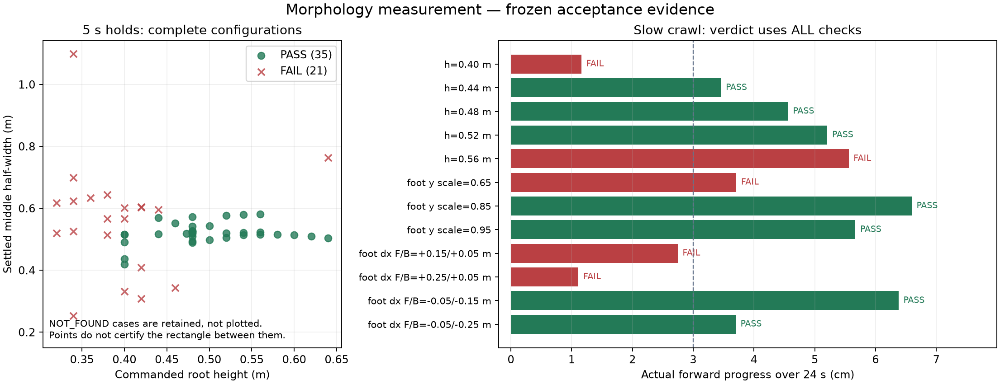

# 形态可达性测量：重构、结果与验收

2026-10-03。当前权威说明。初版的“5/7保持通过、有效限位、可达区间”不能直接沿用；否决理由及原始反例保留在[实验记录](实验记录.md)，原代码和报告保存在`logs/morphology/legacy-glm-20261003/`。本次只重构第一部分的独立测量/验证脚本，未改mjlab架构、既有任务训练或机器人资产。

## 验收范围

本轮验收对象是**当前仿真碰撞模型中的测量方法及明确列出的构型见证**。几何与理想支撑可行、5秒静态保持通过、指定脚本慢速步态通过是三个独立层级；搜索预算未找到、实际试验失败均保留。不把某维的观测极值拼成任意可行的六维范围，不把仿真测量称为实机硬件标定。

最终冻结试验`acceptance-v3-20261003`及冻结副本复验均通过。总流程用时10.85分钟，完整参数、源码/模型/输入SHA及阶段耗时均已保存。

| 验收对象 | 实际结果 | 可使用的结论 |
|---|---|---|
| 核心反例与契约 | 18/18通过；冻结副本再次全部通过 | 完整碰撞体包含、原生距离、真实支撑、根平衡及归一化契约通过 |
| 完整构型见证 | 3,860个全部独立复核 | 当前搜索中的几何与理想接触静力学可行 |
| 静态保持 | 35/67通过；21失败、11未找到构型 | 只将通过的35个完整构型放入静态库 |
| 24秒慢速步态 | 7/12通过，5失败 | 7个构型覆盖标称、不同体高、收缩与前后不对称 |
| 冻结交付复验 | 35个库构型、8,400个运动帧重建通过 | 归档代码和模型可在另一路径执行，不依赖当前目录身份 |

完整见证复核最大几何漏包为1.11e-16m，独立合力/合矩误差分别为3.83e-07N、4.41e-07N·m。冻结库重建最大静态E差2.33e-15m、运动包络违约2.55e-15m。结果都在对应容差内。

T1现在可以为后续teacher提供碰撞体测量、完整关节构型与分层有效性证据。T0既有学习策略的行走复验、姿态间转换、受限空间和非平面地形闭环仍有各自的准入检查；本次脚本步态不能替代它们。

## 坐标、体高与六参数

身体+x向前；fw/mw/bw分别为前/中/后半宽，fl为前缘正x，bl为后缘负x，单位均为米。当前左右对称表达包住实际两侧碰撞体，不要求模型本身严格镜像对称。

测量内部使用`E_h=[fw,mw,bw,fl,bl,h]`：h是BASE原点在同一xy处高于**显式地面平面**的垂直距离。论文的`Δz=h−z₀`仍可由此转换；z₀和联合任务最终动作/归一化范围尚未定稿。本次不再根据错误的足原点平面或穿透逆动力学，声称z₀=0.40m最优。

已知平面时，即使机器人悬空也能测得正确几何高度，但真实支撑无效。`height_valid`表示已知地面，`support_valid`依赖真实承力FOOT–地面接触；少于三足/支撑退化时无有效支撑多边形。`foot_origin_height`只保留为运动学诊断。脚本支持指定斜坡平面并验证实际足底IK；它没有实现从足原点推断台阶/未知非平面地形的估计器，也不给这些情况回填“有效平地”。另存顶部高度、BASE底部净空与非足碰撞体净空，h不是包络箱厚度。

归一化端点按“最小/最大展开”定义，后缘方向显式反转：后缘更负，对应更大展开。`library.json`给出数据集缩放端点与正反变换约定，未将其批准为动作范围；超出观测范围不静默截断为安全标签。高度端点只表示更低/更高，不隐含已选z₀。

## 从完整碰撞体得到水平包络

`meter.py`读取MuJoCo实际编译的凸碰撞网格，保留各个碰撞体及其三角面；该模型共1,542个凸体顶点，原渲染顶点读取约606,954个。点数减少来自使用真正的碰撞表示，未随机下采样或丢弃凸体边界。纯视觉件不加入碰撞占据，LiDAR和支架碰撞件保留。

`hexfit.py`将**每个**凸碰撞体分别投影，加入其边与x=0的交点。在前后两侧分别约束完整填充投影，避免“顶点都在非凸六边形内、凸体却穿过腰部”的漏包。不同碰撞体仍保持分组，避免为腿与机身之间的空隙补出整机凸包。

固定fl/bl为实际占据的最远x，LP最小化`fw+mw+bw`；这不是全参数最小面积或每维独立极值。三个半宽存在耦合，某个拟合半宽可能比物理最大|y|大，不能把它当对应腿的独立关节极限。矩形跨腰部反例、随机真实三角面/腰部交线，以及MuJoCo原生距离查询均进入核心验收。

当前LiDAR碰撞体使fl不能小于约0.640911m，属于这份模型及安装位姿的几何事实。因此EA2旧fl=0.60m不能直接当真实机器人可执行参考；本次没有替换EA2旧参数或重新训练网络。

## 约束来源与静力学

用户已指出URDF约束可能错误。因此测量模型在内存中关闭18个铰链的名义位置限位；保留原值作为诊断，不回写模型。探索域为一圈`[-π,π]`，其边界只是数值搜索边界，不是测得的机械止挡。

单关节扫描只表示“其他17个关节为0时，首次配置内碰撞之前的局部区间”。完整构型仍重新检查碰撞，不能将18个区间拼成机械限位表。父子body、焊接/安装件排除沿用当前MuJoCo模型；这些排除不证明真实关节内部永远没有机械干涉。验收使用实际碰撞、接触、保持/运动轨迹，未知机械止挡仍须实机测量。

新的静力学门求解接触力，而非将足底人为放到−5mm后仅比较18个逆动力学负载：

- 浮动根六维力与力矩平衡同时成立，无根部执行器或外加支撑力。
- 足底接触点法向力单边非负，切向力满足保守L1摩擦锥；本轮摩擦系数1.0。
- 最小化所需关节力矩的最大绝对值，记录全部接触点/力、18个力矩及残差。
- 几何采样不按未标定URDF力矩限删候选；静态保持和运动记录实际施加需求。

`mj_inverse`仅作为末态诊断，并明确`certifies_equilibrium=False`。保持验收另检查静止尾段的非驱动根残差；静力学解由独立的重力+接触合力、绕COM合矩及Jacobian力矩复算核对。

PD仍为kp=130、kd=2，仿真施加力矩裁剪80N·m，验收峰值要求≤64N·m。这些是已声明的仿真假设，不是新测得的实机电机能力。`library.json`逐关节导出接受轨迹的角度跨度、速度峰值及施加力矩峰值；这些是观测需求，不能直接改名为硬件限值或安全变化率。

## 采样和可达构型库

固定水平根姿态，h=0.20–0.64m、步长0.02m；每腿足xy范围x=−1.2–1.2m、y=−1.0–1.0m，步长0.05m。剪枝使用连杆长度及实际足碰撞体半径的保守距离界；以真实足底到平面距离进行多分支IK。逐腿先查腿内/机身碰撞和≥5mm非足净空，完整组合再查跨腿碰撞、≥5cm理想支撑余量和整体静力学。

每腿top-8候选、每方向最多256种组合；每高度共256次新静力学求解，均匀分给标称方向与五维min/max共11个方向。未用完配额不推断不可行；因配额未计算的构型不缓存成物理失败。全部找到的完整构型进入观测汇总，而不是只取每个命名方向的首个成功结果。方向失败类型、候选关节/足位数组、每个边界的完整见证均保留。

共277,242个目标、80,770次IK目标求解、90,946个IK分支解，保留29,245个逐腿候选，得到3,860个完整构型。非标称方向找到见证的格数由v2的7提高到v3的158（总计23高度×10方向）；这是覆盖率改善，不是全局边界认证。

| 参数 | 几何/理想静态见证的观测区间 | 实际保持通过子集的观测区间 |
|---|---|---|
| front_width | [0.024981, 0.864461] | [0.268331, 0.427811] |
| middle_width | [0.253003, 1.342467] | [0.419086, 0.581525] |
| back_width | [0.009633, 0.887779] | [0.294374, 0.451141] |
| forward_limit | [0.640911, 1.011186] | [0.640911, 0.739153] |
| backward_limit | [-1.011186, -0.502999] | [-0.739483, -0.519462] |
| h | 已找到完整见证的网格高度0.34–0.64m | 已接受末态实际高度[0.375433, 0.629175]m |

接受轨迹中观测到的最大关节速度为3.573rad/s，施加力矩峰值为29.532N·m；两者只是这些保持/慢速运动轨迹的需求，不作为硬限值。

这些区间只描述当前搜索找到的见证。最低成功高度、最高网格高度均非物理边界；“预算未找到”也不等于不可行证明。第一轮`acceptance-v2-20261003`显示标称方向先消耗了预算；当前版本修正公平分配，并保留这一中间版本及失败试验作为覆盖率改进证据。

`library.json`仅导出实际通过保持的完整根/关节构型；其中通过慢速步态的案例再提高验证层级，并提供运动采样包络。使用时按完整见证选择候选，重新检查目标空间和过渡；不得独立混合min/max角度或六参数端点。

## 静态保持与慢速步态

保持从足底至少1mm清地的有限状态开始，物理步长0.005s、运行5s。逐物理步检查真实自碰撞、非足碰地、搜索域、警告、姿态、漂移和力矩；末段要求足支撑、COM余量、根/关节静止、目标体高与实际静力平衡。异常自碰/非足接触采用1e−6m穿透容差或>0.05N接触力拒绝，足底正常接触允许软接触穿透。

还检查平均/最差关节RMSE<0.15/0.20rad，倾角<5°，漂移<3cm，尾段根线/角速度<0.01m/s和0.02rad/s、关节速度<0.05rad/s，目标体高误差<3.5cm，末态至少4个真实承力足且支撑余量≥3cm。截短保持时长不能通过完整协议。

慢速步态为单足依次摆动的六足crawl，两轮24s，50Hz足底IK、200Hz物理。每轮指令步长3cm、每足相位2s、摆动抬足4cm；指令平均速度仅0.0025m/s。基于规划接触静力学的重力补偿和横向机身位置反馈，不对浮动根施加外力。此控制器使用仿真真值，仅用于T1测量验证，不是部署actor，也不证明现有PPO策略已会变形。

慢速运动的自碰/非足接触与施加力矩检查覆盖起步、crawl和收尾；在24秒crawl阶段要求实际至少4足支撑且余量≥3cm、倾角<5°、横漂<3cm、IK/规划受力有效，并且实际向前至少3cm。收尾保持2秒后检查末态根速度和实际接触平衡。峰值施加力矩仍须≤64N·m。所有12个预先指定案例都保留；不是仅记录通过的视频或姿态。

| 预先指定的案例 | 静态保持 | 慢速步态 | 实际前进 | 运动失败原因 |
|---|---|---|---|---|
| `height_0.40_width_1.00` | PASS | FAIL | 1.16cm | no_self_or_nonfoot_contact_all_steps, forward_progress |
| `height_0.44_width_1.00` | PASS | PASS | 3.46cm | — |
| `height_0.48_width_1.00` | PASS | PASS | 4.56cm | — |
| `height_0.52_width_1.00` | PASS | PASS | 5.21cm | — |
| `height_0.56_width_1.00` | PASS | FAIL | 5.56cm | planned_contact_balance |
| `contract_0.65_h0.48` | PASS | FAIL | 3.71cm | no_self_or_nonfoot_contact_all_steps, actual_stance_feet, actual_support_margin, nominal_torque_headroom, tilt, lateral_drift |
| `contract_0.85_h0.48` | PASS | PASS | 6.60cm | — |
| `contract_0.95_h0.48` | PASS | PASS | 5.67cm | — |
| `asym_+0.15_+0.05_h0.48` | PASS | FAIL | 2.75cm | forward_progress |
| `asym_+0.25_+0.05_h0.48` | PASS | FAIL | 1.11cm | forward_progress |
| `asym_-0.05_-0.15_h0.48` | PASS | PASS | 6.38cm | — |
| `asym_-0.05_-0.25_h0.48` | PASS | PASS | 3.70cm | — |

旧b1/c在本轮严格保持中均失败；旧d/e/stand通过。旧a/b2继续失败。这里采用新的真实高度和清地起步协议，不声称轨迹与旧记录逐字节相同；旧协议的原样重跑见历史审查。

通过静态保持的最窄/较低姿态未必通过运动；运动失败原因以记录的`failed_checks`为准，即使前进量达标也不能忽略其余检查。运动包络在每20ms测量帧上包围完整碰撞体，并由冻结源码重建逐帧三角面复核；它不是连续时间扫掠证书。自碰/非足接触检查覆盖每5ms物理步，受限场景仍需要独立连续运动/通行验证。



## 代码、冻结证据和复现

| 模块 | 职责 |
|---|---|
| `meter.py` / `hexfit.py` | 编译碰撞体、状态测量、真实接触/地面、完整投影包络与足底IK |
| `statics.py` | 根平衡、单边接触/摩擦和关节需求求解 |
| `analyze_ranges.py` / `sample_reachability.py` | 局部碰撞扫描、分预算完整构型采样与观测边界 |
| `build_cases.py` | 预声明的36个体高/收缩/前后不对称案例，保留IK或碰撞分支未找到 |
| `verify_hold.py` / `verify_gait.py` | 完整保持与脚本慢速运动协议，失败类型及轨迹 |
| `replay.py` / `run_checks.py` | 三角面/边复核、接触力/矩独立复算和反例门 |
| `export_library.py` | 分层验证的完整构型库、数据集归一化及观测关节需求 |
| `pipeline.py` / `provenance.py` / `verify_bundle.py` | 独占新run目录、实际参数/源码/模型/输入身份、冻结复验 |

最终证据为`logs/morphology/acceptance-v3-20261003/`；导航用的小型冻结身份记录见[evidence/release.json](evidence/release.json)。目录包含15个源码的可执行包副本、原XML及mesh副本、依赖版本和SHA256，候选NPZ、全部见证/保持/步态轨迹及失败。初版结果和旧否决证据独立保留；先导试验未冻结源代码，不作为最终验收依据。

在仓库根目录，激活现有hp_mjlab环境后：

```bash
conda activate hp_mjlab
PYTHONDONTWRITEBYTECODE=1 OMP_NUM_THREADS=1 python scripts/tools/morphology/pipeline.py \
  --workers 12 --out-dir logs/morphology/my-new-run

# 不重跑IK搜索：对交付的冻结源码/模型复执行核心门和全部见证，重建接受的运动帧。
PYTHONDONTWRITEBYTECODE=1 OMP_NUM_THREADS=1 python scripts/tools/morphology/verify_bundle.py \
  --run-dir logs/morphology/acceptance-v3-20261003 \
  --out-dir logs/morphology/my-new-verification
```

输出目录/文件已有时拒绝覆盖。每个CLI的0退出码可只表示试验记录完成，单个姿态是否通过看`verdict`；端到端流程和冻结复验只有相应门全部通过才返回0。源码、模型、参数或依赖升级后应生成新run，不重写旧证据。本轮精确命令和实际耗时在`acceptance.json`及各阶段`provenance`中。

## 阶段收尾与质量审查

2026-10-03收尾结论：**T1测量方法和分层构型见证通过验收，可以结束这一轮开发**。审查检查了判据、反例、失败分母、独立复算、源码身份和主目录交付；不是对所有未知构型的安全认证。

| 原问题或交付风险 | 本轮处理与复查证据 |
|---|---|
| 非凸腰部漏包、只看渲染顶点 | 实际编译凸体分组、完整填充投影约束；反例门和3,860个见证的独立三角面复核通过 |
| 悬空足被当支撑、足原点被当地面 | 显式平面高度与真实承力接触分开；悬空、抬足、斜坡足底IK反例通过 |
| 忽略浮动根平衡、将逆动力学负载当安全证明 | 求解接触力并复算根合力/合矩、摩擦与关节需求；保持末态另查非驱动根残差 |
| 旧b1/c误报通过、缺少运行期碰撞检查 | 旧b1/c均被拒绝；保持/运动全物理步检查自碰和非足接触，所有失败保留 |
| 首个找到的构型被当全局极值、方向配额饥饿 | 记录完整见证与观测极值；均匀方向配额；未找到不等于不可行；不输出可达笛卡尔盒 |
| URDF名义限制、统计需求被当硬件能力 | 内存关闭名义位置限位；数值域、观测需求与尚未标定的硬件能力明确分开 |
| 结果来自旧源码或只在当前路径有效 | 冻结15个源码、XML/STL及输入；异路径复执行、35个库构型和8,400运动帧重建通过 |
| 同步主目录时覆盖用户其他修改 | 主目录15个测量模块与冻结源一致；原有12项代码/资产等修改的SHA保持一致；未改Git索引 |

主目录同步后的复验为`logs/morphology/acceptance-v3-main-verification-20261003/verification.json`，同步审计为`logs/morphology/acceptance-v3-20261003/main_sync.json`；阶段收尾机器记录见`logs/morphology/stage-closeout-20261003/quality_audit.json`。源码和证据已同步到`/home/t3chichi/Hexapod-MJLab`，测量阶段结束时仅完成同步；随后已由提交`3fb9bbd`将测量工具、报告和冻结见证库纳入本地main。

剩余项是明确的后续研究边界：机械止挡/执行器实机标定、全局可达范围、构型转换、连续扫掠、非平面地面估计及学习策略闭环。本轮7个运动见证只证明指定24秒crawl，平均指令速度0.0025m/s。[T0-A实际基线与管线](../../tasks/el_4090_lidar/T0-A使用与验收.md)已完成严格验收；下一轮为T0-B正式学习行走。

## 后续使用边界

T1工具和已验证构型可用于细化六维teacher，但优先从通过指定慢速步态的子集起步；静态见证需继续验证转换与运动，纯几何见证只用于研究候选。T2仍要统一物理、LiDAR和监督场景；T3仍要明确时钟、坐标与可观测性；T0学习策略行走复验仍是受限闭环前置。

后续定稿z₀、目标范围及形态用途时，应使用此版本的真实高度与分层见证，避免继续沿用原5/7、全局下界或力矩最优结论。未标定的机械止挡、执行器能力与不属于第一部分的闭环研究不在本次验收中冒充完成。
