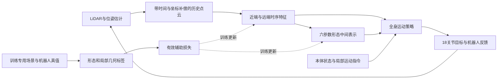

# 毕业设计联合任务准备与细化方案

2026-10-03。依据开题报告v6第3节、第4节、第6.1节、当前两个任务代码与迁移/实验记录。报告提出研究目标；以下为技术准备方案，不将尚未实现的能力写成验收结论。oracle已完成固定0.10米主配方选型及任务内部集成；边界与主分支状态见[oracle选型与验收](../tasks/envelope_adaptive_2/oracle/选型与验收.md)。本文件不实施第三个联合任务。

## 当前可以复用的两块基底

| 基底 | 已有能力 | 联合任务中拟复用 | 当前边界 |
|---|---|---|---|
| `el_4090_lidar` | 18关节MuJoCo/mjlab环境、动作/接触/奖励、近远点云、PPO与高度图辅助监督、导出 | 真实机器人动力学、传感器内核、策略执行、训练/检查入口 | 感知GRU每次从零隐藏状态读取点序列，`is_recurrent=False`；远端池含历史点，不等于已实现跨控制时刻的循环策略。高度场不能表达地面与顶棚共存；基础行走稳定性仍需复验 |
| `envelope_adaptive_2` | 187射线+3运动量、5维形态、跨时间GRU、独立监督采集/训练/评估、几何可视化 | 参数几何、标签生成、时序训练与复位范式、数据溯源和显示 | 载体是脚本运动的包络，并非18关节机器人；2D几何安全不等于真实腿部、支撑、关节或连续运动安全；旧少量训练的验证R²为负，不能当作成熟感知模型 |

代码定位：感知模型实际位于`src/hexapod_mjlab/rl/actor_v2.py`、辅助PPO位于`src/hexapod_mjlab/rl/ppo_lidar.py`；EA2网络位于任务内部`sl/model.py`。

用户主工作区还有未提交的LiDAR实体模型、安装位姿、观测实现等修改。这些修改需在后续工作开始时作为实际基线审查，不能被本次迁移覆盖或混入本次提交。

## 研究目标与整体链路

研究范围是依靠近远端三维感知和跨时间记忆，使六足机器人通过受限空间；形态和局部几何监督作为联合策略的辅助损失。全局SLAM/路径规划不作为本阶段核心，仿真与实机的交付范围仍需定稿。

actor只接收可部署的传感器、状态估计、指令及自身预测；teacher真值不能泄漏到actor。critic特权输入属于待定选项。继续复用MuJoCo/mjlab训练与仿真框架，新增能力放入新任务及确有共用价值的工具，不改整个框架。

EA2现有水平参数顺序为前/中/后半宽、前缘x、后缘x；范围分别为0.3–0.6、0.3–0.7、0.3–0.6、0.6–0.9、−0.9–−0.6米。归一化0/1表示最小/最大展开，后缘越负展开越大。六边形关于身体x轴左右对称，不能表达单侧独立收缩；是否扩展表征应由真实机器人及失败案例决定。

EA2实际输入为187距离+3运动量=190维，与开题报告中193维描述存在版本差异，应在论文注明。它的GRU按时间递归；EL4090现有GRU按点序列递归。EA2以50Hz消费10Hz重复扫描，不具备历史点云运动补偿；新点云时序方案需独立定义，不能直接改变旧权重频率契约。

## 第一优先级：先确定真实机器人能够实现的形态

开题报告的六参数是`E=[p1,p2,p3,p4,p5,Δz]`，第六维描述相对于基准姿态的垂向调整。报告图4-1是形态表达示意，不能据此直接把Δz当作包络箱厚度。真实机身升降会改变腿部工作空间和支撑，不应只把二维轮廓沿z拉伸。

准备一个任务内的几何测量原型：输入关节角、根姿态、六个足端及接触状态，输出机身/腿段占据、5维水平描述、机身相对地面高度、支撑与关节余量。几何基准使用真实碰撞体和运动学，而非渲染STL边界。先在固定根姿态下采样与FK/IK检验，之后在MuJoCo中静态保持，最后在慢速步态中复验。

需要形成以下产物：

1. 每维单位、正方向、归一化与可用范围；目前EA2前/中/后半宽和前/后伸只是原任务范围，不能直接视为六足机器人可达范围。
2. Δz的地面基准定义及估计方法；建议以支撑足/局部地面估计的参考高度描述机身升降，并另存实际顶部/底部占据。斜坡、台阶和足端悬空时要有有效性标志。
3. `E → 可达构型集合`的近似；允许同一E对应多种关节动作，不把形态变成固定关节轨迹。对横向收缩、前后不对称、低趴、抬升分别记录可达性与支撑余量。
4. 实际包络与目标包络关系。建议先将E作为通行形态引导/空间上界，用通行成功与真实碰撞判定最终成效；不要为了精确撑满参考轮廓而牺牲通行。
5. 关节目标、速度、力矩和变化率约束来自模型/执行器；本次oracle使用的2m/s、0.5m/s是几何任务参数，不是已验证的关节动力学限值。

准入：低速平地稳定行走通过，受选形态能静态保持且无关节越限，再进入受限空间闭环。不能仅以训练奖励上升替代这些检查。

## 第二优先级：一份三维场景同时服务物理、感知与监督

保留mjlab架构，在新任务目录内定义场景原语：地面、侧壁、顶棚、台阶/块状障碍、入口/出口与难度标签。由同一描述生成MuJoCo碰撞体、LiDAR raycast网格、训练真值和评测信息。多层几何用box/mesh表达，不继续把低顶塞进单值高度场。

最小场景顺序：空旷平地 → 单个直线窄通道 → 单个低顶 → 台阶/块状障碍 → 斜角/转向 → 侧向与顶棚组合。训练种子与测试尺寸/组合分开；测试保留所有失败和不可行案例。

评测中应同时有几何可行通道与不可行通道。前者要求通过，后者要求及时减速/停住；不能把“最小形态都无法通过”仍强制运动的脚本轨迹作为必须持续输出可执行标签的样本。oracle应区分当前几何可行、时序调整可行、机器人可达及预测不可行，控制任务需要对应的停止/失败语义。

准入：任意抽样的障碍位姿在物理碰撞、LiDAR命中和真值距离中一致；机器人、地面、顶棚的碰撞过滤一致。真实机器人自遮挡要先建立，不能依靠旧脚本载体无实体的理想扫描。

## 第三优先级：补齐时间、坐标与可观测性契约

控制50Hz、LiDAR10Hz目前可以作为起点；每个点云帧至少携带采样时间、当时传感器/机身位姿、命中/缺失掩码、环境与episode身份。将历史帧变换到当前机身系，保留age与有效掩码，区分未命中、dropout和未刷新。部分reset只清该环境的点云历史与网络隐状态。

EA2旧ego横向是右向正值，真实通用身体坐标通常采用左向正值；本轮在任务teacher适配层解码，旧数据格式保留。联合任务需明确新规范和版本转换，不能以字段名相同假定语义相同。

近端用于周围净空/形态，远端用于提前调节动作，初始划分应由机器人实际占据与制动/收缩距离推导，之后做消融。范围、历史长度、点数不是必须照搬256/10×64，也不必继续保持187射线作为唯一输入。

先做信息充足性实验：同一传感器观测是否可能对应不同的后侧障碍/形态标签？遮挡与未扫描区域的误差有多少来自不可观测性？完整地图oracle可以用于训练标签，但网络无法凭前向射线准确恢复所有未见后侧约束。标签的几何有效性与观测支持程度应分别记录；不能把oracle安全直接宣传为网络预测安全。

准入：静止/匀速/偏航/原地转向/部分reset与传感器掉帧中的坐标、时间、age和历史清理通过；再比较单帧与时序输入。EA2按时间递归与EL4090按点序列递归应明确分工。

## 第四优先级：统一监督语义，再接联合训练

任务内建立teacher契约，输出形态、逐维/逐帧有效性、不可行原因、余量及算法版本；训练专用输入是场景真值/机器人真值，actor输入仅来自传感器、本体状态、指令与自己的预测。不可行样本不填最大展开伪标签，也不通过NaN污染网络；以显式掩码跳过相应损失并统计分母。

建议的训练路径：

1. 在真实机器人数据分布上预训练形态与局部几何辅助头，检查未知地图、遮挡、噪声的安全率与时序误差，建立常数预测/单帧/时序基线。
2. 先让固定或预训练感知与稳定行走策略完成一个直线窄通道闭环，明确形态是否能被策略利用。控制端使用网络预测而非teacher真值。
3. 同步解冻感知、形态与控制，加入PPO与有效监督损失。六参数形态头属于策略网络的可解释中间表示，不建立两个分别训练后永不更新的独立在线模块。
4. 再进入低顶与多约束组合；依据实际任务收益决定辅助损失权重与课程，而不是预先声称联合训练一定更好。

循环PPO的关键准备是按时间/环境存储隐状态与done掩码，mini-batch按序列取样；不能只把`is_recurrent`改为True。共享actor/critic感知权重时，优化器参数必须去重，aux loss读取同一次前向的特征；还要核查symmetry/mirror loss对形态参数与点云的变换。局部几何辅助目标应包含地面与顶棚净空/占据，旧187维地面高度图不足以代表三维空间。

原奖励中的固定体高0.25m、姿态保持、腿位/步态约束需逐项检查：低趴/抬升时应跟踪允许的目标高度或任务区间；允许必要姿态变化仍要约束失稳、滑足和越限。奖励修改在新任务中进行，保持已有任务可复现。

准入：masked损失与梯度检查、reset隐状态隔离、teacher不泄漏到actor、旧checkpoint识别、序列/单步导出一致性通过；短训练只验管线，最终成效需多种子真实通行评价。

## 实验矩阵与最终判别

论文还应保留一个有实际控制意义的传统分层基线，明确各基线可用信息与训练容量；点云/体素表征比较可在闭环成立后追加。通行成功定义为进入指定入口并从指定出口通过，不能通过绕开受限通道计成功。固定机器人、指令、场景/种子、训练预算后比较：无形态、仅体高/姿态指令、六参数包络引导；单帧与时序；仅近端与近远端；无aux与形态aux与形态+局部几何aux；预训练固定与联合更新。先使用小矩阵排查因果，再扩大，避免一次改网络、地形、奖励和动作接口后无法归因。

| 对象 | 主指标 | 必须共同报告 |
|---|---|---|
| oracle标签 | 几何安全、机器人可达、有效覆盖、时序调整可行 | 不可行分母、最坏案例、求解耗时；静态离散姿态与连续扫掠区分 |
| 感知/形态网络 | 各维误差、未知地图几何安全率、TV/速度/加速度、延迟 | 有效标签数、常数基线、缺失/遮挡条件；不以R²单独代表安全 |
| 全身策略 | 可行场景通过率、不可行场景停止率、碰撞/跌倒/越限 | 速度误差、支撑/滑足、动作变化与力矩、未见尺寸与组合、多种子区间 |
| 消融 | 同预算/同场景的成效差异 | 每项的训练稳定性、失败类型、额外成本，不只挑成功视频 |

## 可直接推进的准备与待定稿项

下一次开发可以先进行只读奖励/观测审计、实际机器人形态测量原型、三维单场景一致性检查和时序数据契约设计。这些准备能减少之后同时调试三条链路的工作量。

还需与用户定稿：Δz的参考与最终范围；形态作为引导还是严格占据上界的论文表述；首个闭环主场景及指令/停止语义；critic是否使用特权输入；论文主消融优先级；实机验证是否纳入必交付范围。上述建议不是已经批准的最终实现决定。本次授权允许细化方案，未据此实现新联合任务。

## 建议的后续任务流

此表是准备工作的依赖顺序，不是已开始的第三个任务。T0–T3优先完成，避免在PPO里同时调试机器人、场景和标签。

| 步骤 | 依赖 | 具体产物 | 进入下一步的证据 |
|---|---|---|---|
| T0 实际基线审计 | 本次合入 | 用户主工作区资产/挂载/碰撞/奖励差异清单，稳定行走复验 | 18关节有限、真实接触/自遮挡正确、现有行走基线可复现 |
| T1 形态测量与可达性 | T0 | FK/IK采样与静态保持工具，五维+Δz定义、范围及余量表 | 被选形态可以稳定实现，且对应真实碰撞体 |
| T2 三维单场景 | T0；T1定义 | 一份窄通道/低顶box描述生成物理、raycast和真值 | 三者位姿/距离一致，明确可行和不可行测试案例 |
| T3 时间与数据契约 | T0 | 控制/雷达时钟、历史坐标、age、reset与actor/teacher字段表 | 50/10Hz、转向、掉帧、局部reset下不串环境、不读未来 |
| T4 六维teacher原型 | T1–T3 | 场景与机器人约束共同生成标签，geometry/rate/reachability/observation支持标志 | 完整几何与机器人检查均通过，失败分母和耗时记录齐全 |
| T5 首个闭环 | T1–T4 | 单窄通道中的预测形态+已有行走策略原型、停止语义 | 相同条件下比无形态基线通行更好，无法通行时停住 |
| T6 联合训练与研究评估 | T5 | 循环PPO rollout、有效aux、导出；多种子消融与未见场景 | 通行/安全/动作代价有可归因收益，再扩展低顶与组合任务 |

本轮确定的二维teacher可作为T4的几何与时序参考实现，但不能直接给真实机器人六维标签盖安全章。T1和T2的结果可能要求修改形态表达或teacher约束；这是研究问题，应在网络联合训练前识别。

## 部署与来源边界

TorchScript/ONNX导出只能证明相应推理接口可用，不能替代实机部署验收。若实机纳入范围，还需验证点云预处理、位姿/线速度估计、频率与延迟、关节标定和指令映射；仿真真值本体状态不能直接假定在实机可得。

团队原项目的共同代码是依赖背景，个人已完成成果按EA2模块及实际修改记录归属；引用其他任务、共享运动学或控制工具不等于这些代码均由个人完成。原始来源和冻结哈希保留于迁移验收与测试清单。
