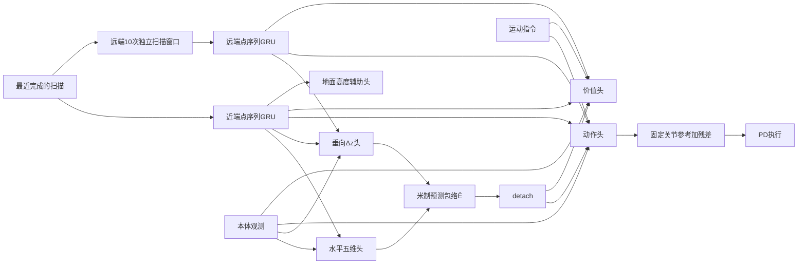

# 联合训练架构

更新：2026-10-13。历史代号说明：本文中的 `P0–P9`、`P6/P8/P9` 等表示当时的工程批次，不作为当前入口名称；数值与验收结论保持原样。主干设计和首版管线工程验收通过，历史工程证据与当前源码验收边界见[工程验收与复现](../tasks/confined_locomotion/training/工程验收与复现.md#历史工程门与当前源码门)；正式学习未开展。本文件维护网络连接、形态含义及信息和梯度边界；研究范围见[第一阶段任务说明](../tasks/confined_locomotion/第一阶段任务说明.md)，数值见[平地说明](../tasks/confined_locomotion/平地学习与基准测量.md)。当前[接口与约定](../tasks/confined_locomotion/framework/接口与约定.md)及[功能状态](../tasks/confined_locomotion/training/功能状态.md)按能力范围引用；历史必要结论按保留报告及原始路径/SHA身份查证；本任务两份完整旧归档已删除。

“已确认”表示用户已作出选择；“正确性要求”用于核对实现是否符合该选择；“待定”内容须在相应步骤开始前确认。开题报告和旧任务提供研究依据，不替代当前决策。当前真实接入与训练缺项见[整体状态](../tasks/confined_locomotion/training/功能状态.md)；原33项核对只描述2026-10-05纯计算快照；当前接口见[接口与约定](../tasks/confined_locomotion/framework/接口与约定.md)。接口支持或配方确认不等于实际提供器/更新已完成。

## 1. 已确认的主干

| 链路 | 当前决定 |
|---|---|
| 感知输入 | 近端当前扫描256点；远端每扫描64点，保留最近10次独立扫描；雷达10Hz、控制50Hz |
| 点云表示 | 原始米制xyz三维输入；正常无命中保留最大量程端点；缺失槽位填0并以掩码排除，不重复点或扫描补齐 |
| 时序处理 | 保留采集时机身坐标，拼接后按角度排序；每次GRU前向从零隐藏状态开始，不跨控制步保存隐藏状态，不做运动补偿 |
| 形态预测 | 水平五维头读近端特征和本体；垂向头读近远端特征和本体；均不读指令 |
| 形态输出 | 模块内用Softplus、r=1映射为物理量，对外返回五维水平参数和Δz，单位米；具体初始化见平地说明 |
| 地面辅助 | 近端特征预测固定机身xy位置沿机身z轴的地面带符号相对高度；先建设可配置网格与真实标签链路，任务跑通后通过覆盖可视化精调最终尺寸（见启动配置第3节）；不设独立顶棚辅助头 |
| 控制与价值 | 共同读取近远端特征、本体、指令和detach(Ê)；actor/critic同信息，共享编码器和形态头，动作/价值头独立 |
| 梯度 | 截断PPO通过包络输入更新形态头的路径；辅助损失训练形态头，PPO经感知直连路径继续训练共享编码器 |
| 执行 | T1固定名义关节参考加18维残差，纯PD；首版沿用±100动作裁剪和旧名义/软位置限位，具体数值见平地说明 |
| 接触与结束 | 非足环境接触和自碰撞分别计罚；足端复用旧力比绊碰机制；碰撞本身不reset，独立跌倒/翻转可结束 |
| 启动与基准 | 始终使用预测包络；启动参考固定，预测包络引导权重为0，平地另加入固定高度跟踪验证；稳定行走后测E₀/h₀，再启用预测形态引导并复验；数值见平地说明 |

本体63维表示供网络消费的线/角速度、单位重力方向、关节参考偏差、关节速度和上一步动作观测；干净模式使用真实仿真测量，首版训练按已选规则扰动观测副本，真实状态与PD/奖励不加噪。3维指令表示期望机身速度，单独保存和缩放。接口分列不会减少actor/critic的信息：控制输入仍拼接两者及近远感知和detach(Ê)。这同时落实形态头不直接读取指令的既定信息边界；地面头只读近端特征。形态预测仍可受动作造成的实际状态变化和共享编码器更新间接影响，不声明与指令在统计上完全独立。旧任务把指令包含在66维观测前缀中，新任务不能沿用旧字段切片、旧镜像函数或直接复用旧输入权重。

远端10次独立扫描窗口替代早期“不保留历史点云”的设想。当前存在点云历史输入，但没有跨控制步的循环网络隐藏状态。网络尺寸、观测倍率、碰撞公式及已确认奖励统一由平地说明维护。

用户已确认仿真与未来实机继续共用最大量程无回波端点表示，不改为仅有效命中点输入、不添加命中通道；有效掩码用于排除真正缺失及填充，不区分命中和正常无回波。实机须在适配层处理合法原始无效测量并恢复射线方向，不能伪造丢包或缺帧；端点不构成实机自由空间证明，具体规则及实现状态见平地说明第2节。

用户已确认首版训练的雷达测距噪声仅作用于实际命中射线的观测副本，在全帧分组/采样前沿原射线方向施加，一次新扫描只生成一次；控制步复用、窗口与PPO更新保持采集时带噪输入。原始命中身份、真实几何标签、物理奖励与采集时刻不改变，也不增加在线输入通道；数值、边界及P6实现/验收状态见平地说明第2节。

用户已确认本体观测的有界均匀噪声：每次新控制观测生成一次，保持机身坐标及已确认倍率，重力观测加噪后归一化；actor/critic及形态头共用同一份带噪本体，PPO更新复用当时保存的输入，不提供额外干净特权输入。指令和上一步动作、真实状态/PD反馈/奖励/终止及几何标签坐标不改变；数值、reset边界及P6实现/验收状态见平地说明第2节。

用户已确认首版不额外添加本体观测或动作执行延迟：策略读取当前控制步本体观测，本次动作直接更新关节目标，各物理子步用真实即时反馈重算PD；不因这一选择增加网络历史输入。已确认噪声仅作用于网络观测，上一步动作仍表示上一控制步实际执行的裁剪后动作；权威规则、reset与待验收状态见[启动配置](../tasks/confined_locomotion/平地学习与基准测量.md#本体观测与动作执行时序)。

## 2. 感知与在线网络

远端窗口只在新扫描完成时写入，控制步间只读。10Hz下满窗的最旧与最新扫描相隔0.9秒。旧实现按50Hz控制步写入，10槽位首末约0.18秒，包含重复扫描；新任务不能直接复用该写入行为。

用户已确认首版沿用瞬时整帧雷达求交，新扫描当步可用，不额外添加雷达延迟或帧内运动畸变。控制步复用造成的观测年龄与额外到达延迟区分，历史坐标不补偿也不表示已模拟逐点扫描；扫描姿态、身份和地面标签时刻保持绑定。权威边界及后续实机时序复核见[雷达配置](../tasks/confined_locomotion/lidar_setup/配置与边界.md#近似边界与证据范围)。本体观测与动作执行时序已另行确认，统一见[启动配置](../tasks/confined_locomotion/平地学习与基准测量.md#本体观测与动作执行时序)。

GRU沿排序后的点序列递归，不沿扫描时间递归。历史点保留采集时机身坐标，移动或转向时同一障碍的坐标会变化，窗口不是对齐后的地图。无梯度采集与play按新扫描复用近/远编码结果，形态、动作和价值头仍按控制步计算；新扫描重新从零编码整个有效点序列，PPO仍按当前权重重新编码并反传。缓存接口与生命周期统一见[接口与约定](../tasks/confined_locomotion/framework/接口与约定.md#点云特征复用)。

reset后不等待10槽填满。写入reset状态并刷新仿真几何后，立即对被reset环境采集首帧，再允许网络控制；以该首帧为本环境10Hz周期起点，其余环境节奏不变。首帧采集/契约故障保存证据并停止；训练正常终止/部分reset和数值异常处理已确认，见启动配置。历史未满或单帧点数不足时，填充槽位由掩码排除；正常无命中端点仍是有效测量。NaN、Inf、缺帧和填充不得伪装成有效点。有效性元数据不增加第四个点云输入通道。

实现须记录扫描身份及环境/episode归属，防止重复写入、旧episode混入和部分reset影响其他环境。纯计算框架已实现零填充、掩码排除与非法输入拒绝；实际分组参数在可视化接通后、训练前确认，当前批次的采集故障规则见任务入口；地面、侧壁和顶棚的实际命中及采样保留率须测量。水平头只读近端，水平参考的观测支持也须核对。

## 3. 参考、预测与实际形态

| 符号 | 含义 | 用途 |
|---|---|---|
| E₀、h₀ | 稳定平地行走后测得的固定水平基准和根高度 | oracle的恢复偏好 |
| E* | 首版平地使用已确认固定启动标签；后续受限阶段由场景真值和机器人约束共同生成参考目标 | 控制步身份绑定的包络辅助标签；平地提供器已在P1/P4工程路径绑定验收，六维受限teacher另属后续 |
| Ê | 网络输出的五维水平参数和Δz | 动作/价值输入及形态引导目标 |
| E_actual | 实际机器人形态的测量或估计 | 跟随评价和占据检查，统计方法待定 |

水平参数顺序为前/中/后半宽、前缘x、后缘x；后缘更负表示向后展开。当前表达左右对称，非对称扩展留后续。基本几何合法性不等于机器人可达性。

oracle以空地舒展水平形态和基准高度为恢复目标，受约束时收缩、下降或抬升。水平与高度联合满足环境和机器人约束，不独立求极值再拼接。六维teacher的代价、可达约束和求解方法待定；现有二维oracle不能代替其验收。

h是根参考点相对地面的垂直高度，正式目标为h_target=h₀+Δz，启动期用h_init替代h₀。首轮地面为明确平地，顶棚安全按完整碰撞占据检查。非平面地面的高度参考留后续。

用户于2026-10-07确认：当前平地高度验证奖励采用固定h_init目标，预测Δz继续作为网络输入及辅助监督输出；后续高度跟踪奖励改为跟随预测h₀+Δz，不额外注入独立变化高度目标，也不同时保留固定高度跟踪项。实际高度仍为上述竖直相对高度，可用机身坐标相对地面向量与重力方向投影计算；它与地面辅助沿机身z查询的带符号高度含义不同。权威数值及测量/奖励边界见[平地高度验证](../tasks/confined_locomotion/平地学习与基准测量.md#平地固定高度验证与后续预测目标跟踪2026-10-07用户确认)。

包络辅助使Ê逼近参考目标E*，不直接使实际机器人形态E_actual逼近Ê。预测仍作为actor/critic输入，且共享编码器参与联合训练；detach只截断PPO通过包络输出更新形态头的梯度，不移除前向信息连接。形态跟踪奖励负责鼓励实际动作实现目标；用户确认当前平地完整预测形态跟踪暂不启用（含水平及预测高度），固定高度项单独承担高度控制验证，包络辅助监督继续启用。机器人实际行为和预测/参考误差分别观察，预测准确不能替代实际形态跟随的证据。

E₀/h₀在稳定行走后测量，应覆盖完整步态占据和高度变化。单帧站立、各维独立极值及EA2旧范围均不能直接认证为可执行行走形态。

## 4. 辅助损失、奖励与数据时刻

基础总损失为`L_total = L_PPO + λ_E L_envelope + λ_H L_ground`；基础GPU验收后添加已确认的左右镜像增强及`0.6 L_mirror`。镜像关闭时系数为0，具体接入顺序和均值镜像公式见启动配置。两类参考误差作为加权辅助项参与联合优化，不要求独立监督预训练；包络六维平方误差求和、地面有效位置平方误差取平均及起步权重已确认，权威公式见[启动配置第3节](../tasks/confined_locomotion/平地学习与基准测量.md#3-地面辅助与启动损失)。独立扫描计数、两级平均及首版平地固定网格几何有效全监督已确认；P2/P3/P4工程路径已验收去重、loss和真实联合更新，镜像按基础门A/B通过后接入，P8/P9真实GPU验收通过。

2026-10-10用户确认P8使用纯左右交换的近似增强，均值损失作为软约束；保留真实模型/T1和既定观测噪声，不加固定偏移或质量/初态随机化。具体映射、已接受的固定参考偏差及工程见证见[启动配置镜像节](../tasks/confined_locomotion/平地学习与基准测量.md#镜像增强与镜像损失及接入顺序已确认p8p9工程验收通过)。原/镜像辅助在同一真实来源内平均，扫描计数不翻倍；既定detach、活梯度和联合优化边界保持。P8/P9真实GPU更新、独立公式复算和完整恢复通过；仅旧mean/std/raw共同置换，当前mirrored分布使用当前各关节独立std原顺序，未硬绑或额外置换；均值镜像目标detach。接受近似及历史工程边界见[镜像设计依据](../tasks/confined_locomotion/reference/设计依据.md#左右镜像的接受近似)。

| 数据 | 对应时刻与保存要求 |
|---|---|
| 包络标签E* | 当前控制步、动作发出前的状态；与该步观测/动作配对，点云可来自较早的最新完成扫描 |
| 地面标签 | 与近端扫描配对；固定机身(x_B,y_B)，沿扫描时机身z轴查询真实地面，输出相对根参考点的带符号高度h_B，单位米；网格跟随完整机身姿态，仅新扫描更新 |
| 形态引导奖励 | 目标使用采样时的Ê；保存实际采样奖励，PPO更新不按当前预测重算历史奖励 |

用户于2026-10-07确认地面标签改用机身z方向的带符号相对高度；原世界竖直差值z_ground−z_root的定义属于早期约定，历史证据不回写。扫描时根位姿为(p_W,R_WB)，每格交点满足p_ground_W=p_W+R_WB·[x_B,y_B,h_B]，位置字段声明为采集时机身坐标[x_B,y_B,h_B]，世界交点另存离线元数据。网格的俯仰/侧倾随完整机身姿态变化；查询方向近乎平行于地面时按显式容差标为无效。此变更不改变包络Δz与h₀/h_init的已有垂直参考定义。

首版平地用户已确认固定网格各几何有效位置均参与监督；遮挡、未命中和FPS未保留不作为逐帧排除条件，近端观测支持单列诊断并用于后续范围精调。网格仍跟随扫描时完整机身姿态，真值标签和覆盖诊断不增加在线输入。合法几何无效仍按mask排除，契约故障按停止规则处理；具体边界见启动配置第3节。

两类标签分别保留控制步或扫描身份。平地固定E*须按当前控制步提供并保存，不能由常量数值省略身份；受限六维teacher的求解频率/缓存及失败处理另定，旧状态参考不能直接标成当前标签。地面辅助在完整rollout内按环境/episode/扫描/网格身份去重，各独立扫描等权、帧内有效位置取平均；正常多轮优化及跨rollout复用允许，具体公式和边界见启动配置第3节。控制步原始记录及策略/价值/包络数据不去重。初始化输出恰好等于固定标签时，零辅助梯度不表示形态头被冻结。

形态引导允许策略权衡跟随、行走、稳定和碰撞。实际形态测量、引导误差及权重待定；接触与足端绊碰规则见平地说明。场景分类和法向仅用于诊断，首版未采用基于它们的新足端奖励。

场景几何真值、teacher及辅助标签用于训练和评价，不输入actor/critic。本体线速度使用仿真测量作为理想估计替代，两者同信息；这不代表实机估计已实现。求解失败、超时、当前位姿无参考和有证据的场景不可通须分开记录，未来teacher标签掩码与求解失败处理待定，不影响上述已确认的首版平地地面监督规则。

## 5. 梯度与实现检查

| 网络部分 | 策略损失 | 价值损失 | 包络辅助 | 地面辅助 |
|---|---|---|---|---|
| 近端编码器 | 直连更新 | 直连更新 | 经形态头更新 | 更新 |
| 远端编码器 | 直连更新 | 直连更新 | 经垂向头更新 | 无连接 |
| 水平/垂向头 | 截断 | 截断 | 更新 | 无连接 |
| 动作头 | 更新 | 无连接 | 无连接 | 无连接 |
| 价值头 | 无连接 | 更新 | 无连接 | 无连接 |
| 地面高度头 | 无连接 | 无连接 | 无连接 | 更新 |

辅助损失使用未截断预测；共享编码器仍可能经PPO直连路径间接改变形态输出。优化器参数须去重，不能将共享特征整体detach或冻结整网。用户已确认一个Adam联合更新去重参数，并对联合梯度单次裁剪；PPO主参数与KL学习率调度数值见启动配置第3节，镜像增强/损失已同意但须先完成无镜像基础链路GPU验收，再添加和开启，具体配方及顺序见启动配置；当前用户已确认采用CUDA FP32、暂不增加混合精度，未来是否加入AMP须按实际负载另议；单Adam联合更新已在P3/P4工程路径真实GPU验收，显式正式配方入口已由P9工程验收，注册默认仍拒绝执行，正式学习与效果门尚未开展。

实现检查包括策略/价值各自的截断、非零误差下的辅助梯度、共享参数更新、标签时间和环境索引、无效值隔离、reset及保存重载。旧动作概率须对应rollout保存的采样动作；本体上一步动作已选裁剪后无量纲动作，原始/裁剪后动作分别记录；P2/P3工程路径已保存原始采样动作及其对应概率，对角高斯、每关节可学习log_std及真实更新均已分范围验收。

## 6. 待定与后续

首版实现状态、精调及后置事项集中在[平地说明第5节](../tasks/confined_locomotion/平地学习与基准测量.md#5-待确认事项与确认时点)，受限配方见[任务说明第6节](../tasks/confined_locomotion/第一阶段任务说明.md#6-受限阶段仍待确认的内容)。

开放包络回传、运动补偿、跨控制步网络记忆、相位参考、复杂地形和特权critic均不作首版默认设计；后续是否开展由基线证据决定。

已完成非训练批次的范围、诊断动作、停止授权与首版自遮挡选择见[任务入口](../tasks/confined_locomotion/README.md)，不改变上述训练架构。
