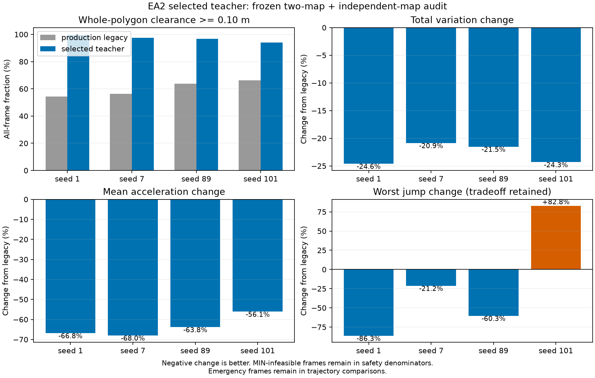

# EA2 oracle选型与任务重构验收

2026-10-03。本阶段已验收并固定为后续开发基线，主方案已完成实验选型、任务内部集成和本地main合入。当前使用入口见[使用说明](../使用说明.md)，研究过程与负结果见[实验记录](实验记录.md)，冻结身份与证据哈希见[发布证据](evidence/release.json)。

## 结论与选型依据

采用 `whole_polygon_preview_axial_v1`：完整六边形的前后梯形精确分解，安全区域局部迭代，当前可观测运动量的短时共同形态前视，以及两条轴向余量约束。固定主间隙0.10米，保留旧oracle的显式legacy路径和全部负结果。

原两张地图全部12,320个有效位姿中，旧生产标签保持原射线间隙0.20米、网格复核间隙0.10米及原平滑设置；平滑标签通过独立完整几何复核6,814帧（55.31%）；新教师返回几何有效12,129帧（98.45%），这些返回值全部通过复核。剩余191帧的最小形态本就不可行，保留在分母中；其中12,127帧可用于监督，另2帧为紧急几何参考。

面积/名义形态比较只用同位姿且旧新均几何安全的样本，避免奖励旧形态穿障。时序比较用新方案当前几何有效的连续帧对，包含旧不安全输出及全部紧急事件，绝不通过删除困难帧美化平滑性。

| 地图 | 几何有效/总帧 | 同安全样本名义MSE下降 | 同安全样本面积增加 | 总变差下降 | 平均加速度下降 | 紧急帧 |
|---|---:|---:|---:|---:|---:|---:|
| 1 | 6124/6160 | 23.74% | 0.89% | 24.59% | 66.83% | 0 |
| 7 | 6005/6160 | 28.27% | 1.22% | 20.86% | 67.98% | 2 |
| 89 | 1820/1880 | 18.48% | 0.06% | 21.52% | 63.81% | 0 |
| 101 | 1769/1880 | 39.14% | 3.72% | 24.31% | 56.09% | 1 |

1/7为原两图；89/101是另外采集的地图。新数据种子与标签来源及所有试验配置、JSON/NPZ、源码快照和失败记录均保留。



## 必须保留的边界

- seed101最坏跳变/速度/加速度相对旧生产标签增加82.79%，该例紧急收缩约5.43m/s；不能称全工况变化率硬保证。seed7紧急事件为t378/379、env7；seed101为t434、env0。无非紧急超速漏标。
- 首轮静态QP、共同旧安全子集的一些总变差指标优于最终方案，例如seed1共同安全子集TV从0.01093变为0.01269。最终方案是整体收益更好的安全教师，不是所有基线、子集和尾部指标全面占优。
- 0.20米敏感性试验的安全输出也通过几何复核，但有效覆盖降低，并且相对旧生产标签（仍按0.10米复核、原设置不变）的TV在四图均上升（约16%–39%）。不将增大间隙的代价伪装成算法失败或普遍改善；同间隙首轮QP比较另行保留。seed101某形态基线MSE近零，百分比失真，应看绝对值。
- 0/0.06/0.12秒三个离散预测姿态只用于形态引导，最终证书是当前位姿的完整几何；不是连续扫掠安全、未来不碰撞或全局最优证书。
- 五维参考不等于真实六足机器人可达构型；当前脚本路径仍可能进入最小形态不可行位置，失败样本保留。机器人任务如何处理该类状态需另定，不能由本报告推出停止/退避训练已经获准。
- 新教师为CPU离线监督实现。实测两环境单批平均20.74ms、p95约45.08ms，不能声称大批量50Hz在线实时计算。网络推理与teacher生成分开评价。

## 固定计算与有效性契约

归一化五维等权；名义展开0.975；物理范围沿用旧任务。时序权重4、前视0.12秒、增长冷却0.10秒、步长0.02秒；参考收缩/增长限值2.0/0.5m/s。近前/后半宽收至归一化0.15以下时，分别限制轴向伸展：`s_forward <= 6.1667*s_front + 0.05`，`s_backward <= 6.1667*s_back + 0.05`。这是方向性几何余量规则，不是运动学证明；正面墙不会无端压缩无关半宽。

`teachers/`是唯一维护的新教师实现；`experiments/`保留兼容入口、首轮冻结基线及被否决候选，过去候选的实际源码保存在按SHA命名的快照里。生产代码不依赖实验脚本或测试几何检查器。

- `geometric_valid`：当前完整包络、范围及轴向余量满足要求。不可行返回有限MIN占位值，但有效标志为False，不会把占位值当作安全参考。
- `rate_checked/rate_valid`：存在上一参考时是否完成并通过参考变化率核验。初始化、reset或不可行后首个静态形态不声称有变化率证书，仍可提供静态形态监督。
- `emergency`：安全优先时未能在局部参考变化率约束下找到输出，放宽收缩约束；原因保留，不宣称全局变化率不可行。
- `supervision_valid`：几何有效且没有紧急事件。它是教师标签有效性，不是关节可执行性。紧急帧只退出监督损失，仍进入完整效果统计。

只在advance/reset计算新参考，读取观测不推进历史；部分reset只清对应环境。新数据版本3保存逐帧五种掩码、状态、原因、配置和源码SHA；主MSE、五档recall/forward端点、可选安全损失、PCA/指标与常量基线均正确处理有效性，不删内部时间帧。全无效损失为可微零，无效NaN标签不污染梯度。

旧数据缺少证书时仍走原监督语义，但不补造几何认证；旧checkpoint缺少teacher元数据时play/eval自动恢复legacy。新数据/模型的版本、配置与源码身份保持一致；不同标签来源禁止静默混训。

## 验收与复现入口

已通过：原源码数值/地图/路径/网络回归，解析几何，独立完整多边形复核，四图生产逐帧重放（全部参数最大误差0），mask与NaN/梯度检查，五档aux两方向，真实GPU采集/局部reset/缓存/在线离线一致性，旧模型恢复，EL4090 LiDAR及模型回归。

工程证据集中在 `logs/ea2/oracle_refinement/20261003/`。科学比较汇总为 `selection_report_v1.json`，完整推导为 `derived_audit_v19_complete.json`；生产重放为 `production_frozen_parity_release.json`。冻结原图、独立图和各次工程语料均保留，不覆盖旧文件。

实际完整发布管线已通过：两图各800×4帧，104个有效窗口，78训练/26验证窗口且环境身份不重叠；5轮、seq400、stride30、batch8、随机种子1，两配方共用同一份数据。基础配方验证MSE=0.03258、R²=-0.3917；五档aux+安全损失配方验证MSE=0.04142、R²=-0.7693。每配方两图×四模式×4环境×450步实测评估、1e-6容差模型重载、带显式reset隐状态的TorchScript导出、最终训练模型play均通过。学生collision_rate明确为旧距离场网格代理指标；面积对照使用相同几何有效帧（包含紧急帧），监督MSE单独使用有效标签掩码。

最终发布语料：`logs/ea2/data/ea2-exact-release-20261003/`；两配方模型及导出：`logs/ea2/runs/exact-release-20261003-{baseline,aux_safe}/`；实际完整管线记录：`logs/ea2/acceptance/ea2-exact-release-20261003/pipeline.json`。短训练仅确认训练/重载/评测/导出可运行；R²为负时照实记录，不宣称网络安全或训练精度提升。

```bash
PYTHONPATH=src conda run --no-capture-output -n hp_mjlab python tests/ea2/test_supervision.py
PYTHONPATH=src conda run --no-capture-output -n hp_mjlab python tests/ea2/test_environment.py --check teacher
PYTHONPATH=src conda run --no-capture-output -n hp_mjlab python -m hexapod_mjlab.tasks.envelope_adaptive_2.sl.scripts.play logs/ea2/runs/exact-release-20261003-baseline/model.pt
```

新采集默认为exact；如需重现迁移版本，采集入口传`--oracle legacy`。play默认按checkpoint恢复教师，也可显式`--oracle exact`进行新参考对照，但此时不代表旧模型已在新标签上训练。

## 后续收益与合入状态

可复用成果包括完整几何、因果参考时序、有效标签/辅助损失、重置隔离、数据/模型来源和公共可视化。2026-10-04更新：机器人限定形态测量及T0-A管线已完成；新任务仍需平地学习、正式基准、六维teacher与三维场景。首版采用点序列GRU和远端扫描窗口，不跨控制步保存隐藏状态，不要求循环PPO。当前路线见[总体规划](../../../research/联合任务方案.md)；本报告的EA2实验结论保持原范围。

最终独立工程审查PASS（只读审查`/root/ea2_plan_review`），最终四图源码冻结重放全部零误差，最终wheel隔离导入通过。任务代码提交`92147e8`，连同迁移保全提交`e69d7cc`，已由`3e59b42`普通快进合入本地main。主工作区12个原有修改/未跟踪文件的内容SHA与Git状态逐项一致。397个数据/模型/实验产物（约100MB）已复制到主项目并逐文件校验，无冲突、无覆盖；在主项目实际代码中加载数据/模型并运行两环境GPU六步也通过。未推送远端。最终文档状态补记单独提交，不修改已验收代码。

## 本阶段收尾与重新验证条件

算法选型、四图复验、任务重构、训练/评估/导出管线、独立审查与本地main交付均已完成。本阶段没有阻塞收尾项，保持当前版本和主配方，不因展示效果继续调参。

紧急变化率例外、二维几何与真实机器人可达性的差别、学生网络尚未充分收敛，作为下一阶段的明确验证目标保留。后续若改变几何表达、参数范围、安全间隙、运动/采样时钟或teacher规则，需要重新进行对应几何、时序和管线验证；若扩展至六维机器人闭环，应另建该任务的验收记录，不能沿用本报告冒充新任务安全结论。
