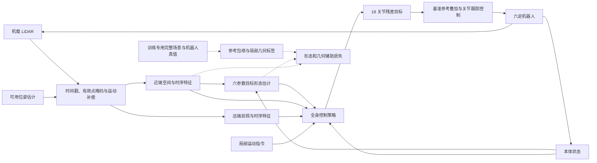

# 毕业设计技术路线与当前框架评估

评估日期：2026-10-02。依据：开题报告 v6 第 3—5 节、第 6.1 节，当前工作树代码、迁移记录和 CPU 检查，以及用户补充的原团队项目 `/home/t3chichi/el4090_legged_gym` 中的 `envelope_adaptive_2`。报告中的方案是研究目标；代码与验收记录用于判断当前进展，二者不能互相替代。

本文件保留迁移前的框架评估。同日按用户批准的规划实施了EA2独立监督学习迁移，
当前状态与实际训练/回归证据见[EA2迁移与验收记录](EA2迁移与验收记录.md)。
下文“尚未接入当前工作树”等描述对应本评估时点。

## 1. 结论与研究边界

**保留 MuJoCo Warp / mjlab / rsl-rl 技术底座，在其上扩展受限空间任务是合理的。当前仓库能够作为开发起点，但还不能作为毕业设计完整方法或已验证的稳定运动基线。**

核心问题是：在给定局部运动指令时，六足机器人能否依据三维空间约束，连续调整机身与腿部构型，稳定穿过狭窄、低顶、地面障碍及其组合。

三项研究内容相互依赖：

1. 局部三维感知与短时历史 → 可解释的六参数目标通行包络。
2. 目标包络 + 近远端环境特征 + 本体状态 + 运动指令 → 18 关节残差目标。
3. 仿真特权几何提供形态标签和局部几何监督 → 感知、形态和控制联合优化；部署移除训练专用输入与辅助分支。

这里的端到端是机载观测到关节目标的联合学习与决策。分阶段预训练可以作为工程路径，最终还需验证联合优化是否有效。目标形态是引导变量，不是完整关节构型，也不是必须精确跟踪的固定轨迹。

范围以局部通行为主。全局 SLAM、路线规划和探索不纳入核心开发；系统性仿真验证是主要成果，实机低速验证为拓展。报告中五维射线预测对应原团队项目的 EA2 模块，已具有独立训练、评估和导出流程，但尚未接入当前工作树。后续应迁移和扩展这一成果；它仍不等于完整六维形态或六足动力学闭环已经完成。详见第 10 节。

## 2. 最终系统的数据关系



部署 actor 的输入必须来自传感器、状态估计和自身预测。环境计算奖励时读取真值是允许的；真值直接进入部署 actor 则会改变课题要求。critic 是否使用特权状态是可选的训练设计，应与 actor 输入契约明确分开。

## 3. 当前仓库具备什么

| 能力 | 实际代码或证据 | 评估 |
|---|---|---|
| 六足机器人模型 | `assets/robots/el_4090/`，18 个主动关节，URDF/MJCF 与关节表 | 可复用；当前站立验证通过，后续需检查收缩、低趴等极端构型 |
| 并行任务与训练入口 | `tasks/el_4090_lidar/config/` 的任务注册、环境与训练配置 | 可扩展；没有必要重写训练系统 |
| 关节残差与 PD 执行 | `mdp/actions.py`，默认参考 + 动作缩放，PD 力矩限幅 | 与报告动作思路基本一致；关节目标边界和变化率约束需补充 |
| 模拟 LiDAR | `utils/lidar/`，Warp raycast；`mdp/lidar.py` 连接任务 | 可复用内核；当前查询对象绑定柱状地形网格 |
| 近远端点云与编码 | `rl/lidar_wrapper.py`、`rl/actor_v2.py` | 有基础实现；空间划分和时间处理需按新任务调整 |
| PPO + 辅助监督 | `rl/ppo_lidar.py`，近端特征预测 187 维高度图 | 已有联合损失入口；没有六参数形态监督和完整三维几何监督 |
| 随机化 | 摩擦、质量、推扰、部分观测与 LiDAR 噪声 | 部分可复用；惯量、延迟、位姿误差等按后续实验补充 |
| 检查与日志 | 机器人、传感器、地形、策略等价检查与训练日志工具 | 适合作为回归底座；目前主要验收迁移，不验收毕业设计通行能力 |
| 六参数形态模块 | 当前策略直接由本体与点云特征输出动作 | 尚未实现 |
| 前期五维包络成果 | 原团队项目 `envelope_adaptive_2` 的几何、oracle、时序网络及 SL 管线 | 已有实现，尚未迁入；应作为形态开发起点 |
| 受限空间场景与评测 | 当前任务为 pillar field，终止主要为超时、翻倒/低机身 | 尚未建立窄缝、低顶、越障与组合任务的完整评测 |

当前主要观测为 66 维本体、256 个近端点和 10×64 个远端历史点，共 2754 维；训练监督组为 187 维高度图。策略频率 50 Hz，物理频率 200 Hz，LiDAR 名义更新频率 10 Hz。以上是当前配置，不应固定为后续研究不可改变的接口。

## 4. 必须优先处理的差距

### 4.1 基础运动尚未达到可信基线

`MIGRATION.md` 最后的 M5 记录：32 环境、200 次迭代、seed=1，新栈约 46% 回合由 `fell_over` 终止；新旧平均奖励也有明显差距。记录将其解释为接触响应差异，但本次没有 GPU 复现和因果排查，不能认定已排除实现、奖励或探索设置的影响。

200 次迭代是短期诊断，不能据此断言框架不适用；也不能把训练能运行视为策略已具备稳定行走能力。首先在平地、低速、较少干扰下验证运动，再逐步加入粗糙地面和感知。使用跌倒率、速度误差和动作/接触表现判断，不能仅看总奖励。没有必要为了毕业设计无限追求与旧引擎曲线逐项一致。

### 4.2 当前高度场不足以表达低顶与悬空结构

当前物理场景使用高度场，LiDAR 使用由同一高度场生成的三角网格。单值高度场不能同时表达同一水平位置的可行地面和可通行顶棚。

本地安装的 mjlab `SubTerrainCfg.function()` 可以向 `MjSpec` 添加多项几何体，官方 primitive terrain 也有 box/mesh 用法。因此三维场景并不要求更换框架。需要扩展的是本项目的场景生成、LiDAR 网格和真值查询接口。

建议由一份场景描述生成：

- 物理碰撞几何：地面、侧壁、顶棚、台阶与块状障碍。
- LiDAR raycast 几何：相同障碍的表面与位姿。
- 训练真值及评测信息：净空、碰撞间隙、起终区域、场景类别和难度。

新增障碍必须同时出现在物理和感知中。不能只在 MuJoCo 添加顶棚，继续让雷达查询旧地形网格。接触传感器也应覆盖所有相关障碍；若仍按 `terrain` body 匹配，新增几何的挂载位置必须与之保持一致。

### 4.3 当前“双 GRU”不等于报告中的时间模型

`actor_v2.py` 的 GRU 每次前向从零状态开始，序列元素是点坐标，近端没有显式跨帧记忆。远端虽有环形窗口，但：

- 每个 50 Hz 策略步写入一次，LiDAR 名义上每 5 个策略步才更新一次；10 个窗口槽不等于 10 个独立扫描帧，通常包含重复帧。
- 历史点保存的是当时机体坐标，没有用位姿变换到当前坐标系。
- 历史点合并后按角度重新排序，没有显式保留时间顺序或点龄。
- 当前近远端划分主要依据角锥，而非明确的周围净空区域与前方空间区域。

这些设计可以保留为旧基线，但不能据此声称已完成运动补偿的时序局部三维感知。

建议先采用固定长度的真实传感器帧窗口：按扫描更新保存点云、位姿、时间戳、有效掩码，在消费时补偿到当前局部坐标系。第一版可用逐帧点云编码再沿时间融合，也可用补偿后的历史点集加点龄特征。两种方案不是同时必须实现的要求。

固定窗口有利于沿用当前前馈 PPO 批处理；若改成跨策略步持续保存隐状态的循环策略，还需处理序列采样、done mask、隐状态重置及现有对称增强兼容性。

### 4.4 六参数表达需要先成为严格的几何接口

报告定义 `E = [p1,p2,p3,p4,p5,Δz]`，图 4-1 给出水平五参数和垂向调节的示意。补读 EA2 后，水平五参数的几何公式、单位、上下界和归一化已有明确实现（第 10.2 节），应继承并核对与报告符号的对应关系。面向完整六足任务还需固定：

1. 继承 EA2 的机体坐标与多边形公式，确定其与 `p1…p5` 的符号对应及新任务的前进方向约定。
2. 核验现有参数范围适配当前机器人，补充可行组合、镜像变换与左右对称表达的适用范围。
3. `Δz` 的参考高度、参考地面和正负含义。
4. 包络描述的对象：机身、全腿外形，还是含安全裕度的整体占据范围。
5. 当前实际形态的提取函数，以及跨动作周期的统计方式。

水平包络加 `Δz` 是紧凑任务表征，不保证描述所有姿态与关节可达性。例如俯仰时最高点改变，摆动腿也可能瞬间超出包络。实际碰撞检查必须继续使用机身和腿部几何，必要时评价摆腿扫掠范围；不能只以足端多边形或包络误差替代安全判断。

### 4.5 参考形态不能只由障碍距离决定

核心难点是“有几何空隙”与“存在连续、稳定的可执行构型”之间的差异。

第一版先在参数化简单场景中构造标签：给出碰撞净空约束，结合机器人姿态/关节候选检查可达性和支撑条件，再按偏离基准、时间连续性等准则选取参考。静态可行性只能作为筛选，最终还需闭环执行验证。

EA2 已实现基于二维距离场的轴向搜索、active-set 联合收缩与快收慢放标签平滑，可作为水平几何参考的起点。新增工作是三维净空、`Δz`、机器人可达性/支撑检验和闭环验证，不必重新从零编写五维 oracle。

同一空间可能有多个有效形态，必须定义参考偏好，避免标签任意跳变。无可行候选时返回明确的不可行标记，对无效监督做掩码，而不是强行生成“可通行”目标。上一时刻参考若参与标签生成，应明确网络获得哪些历史信息，避免产生无法从观测判定的监督目标。

没有必要第一版就实现任意三维空间中的全局最优包络规划器。

### 4.6 旧奖励可能抑制新任务需要的行为

当前奖励含固定体高目标 `0.25 m`、水平姿态约束、小腿姿态及固定步态项。固定体高会与主动抬升/降低直接冲突；较强步态或腿部姿态先验也可能限制收缩和非对称支撑。应按受限任务逐项检验，而非原封不动叠加新的形态奖励。

当前存在动作变化率惩罚、软关节越限惩罚和力矩限幅，但不能把它们等同于关节目标和变化率的硬边界。

后续目标应同时覆盖通过任务、速度执行、形态引导、全身碰撞/稳定、动作连续性。不允许为了降低形态误差而长期停滞，也不能让绕开测试通道成为成功。低趴任务需检查现有低机身终止阈值；地面有高度变化时，不能直接用世界坐标机身高度判断所有跌倒。

## 5. 推荐的渐进开发路线

| 阶段 | 交付内容 | 进入下一阶段的证据 |
|---|---|---|
| A：基础运动与接口 | 平地低速基线；核查接触、动作、关节/足序、观测与复位 | 多组固定测试下稳定行走，有限状态，速度跟踪与跌倒率达预设门槛 |
| B：包络与三维场景 | 迁移 EA2 五维几何与 oracle；补 `Δz`、当前形态测量、三维场景及统一几何 | 可视化形态；射线命中与碰撞边界一致；参考候选可行性可检查 |
| C：形态控制可行性 | 用外部指定目标及简单参考形态训练主动收缩、低趴、抬升 | 能稳定执行目标变化，并通过单一约束场景；这是训练预研，不是最终部署结果 |
| D：真实观测形态估计 | 保留 EA2 时序预测基线，扩展补偿点云、近远端编码、六参数预测与辅助监督 | 留出场景的参数误差、可行率、平滑性与延迟；观察误差对控制的影响 |
| E：联合闭环训练 | 用预测形态驱动控制，协调 PPO 与辅助损失，再加入组合场景 | actor 不读取标签/精确场景；真实观测闭环稳定，联合优化与分模块方案可比较 |
| F：对比消融 | 固定评测集、基线、泛化与感知退化实验 | 可复现的成功率、安全与控制指标，以及失败案例分析 |

阶段 B 可与基础运动调试穿插。阶段 C 优先验证形态接口的控制价值，避免同时改感知、标签和控制后难以定位失败。阶段 D 的输入规范应在联合训练前确定。最终保留训练期间使用预测形态的过程，降低从真值形态切换到预测形态时的分布变化。

**建议首个闭环里程碑：在平整地面上的直窄通道中，从 LiDAR 估计收缩需求，驱动六足整体收缩并稳定穿过。** 它能检验水平五参数的核心作用，也便于和单纯机身体高策略区分。此前需确认最小通道尺寸确实在机器人可执行构型范围内。之后增加低顶，再加入地面越障和组合约束。

## 6. 工程扩展位置

保持现有模块分层，不急于大规模搬迁：

- 保留 `tasks/el_4090_lidar` 作为迁移基线，新增独立受限空间任务，避免修改后失去对照。
- 通用场景生成和查询接口置于现有 `terrains/` 或新增场景模块；任务级课程、奖励和成功判定放在新任务 `mdp/`。
- 形态几何、当前形态测量和参考候选筛选放在独立形态模块，避免塞入点云 wrapper 或 PPO。
- 通用点云历史与运动补偿归入 `utils/`；可学习的编码、形态头和动作头归入 `rl/`。
- 扩展辅助损失时，继续保证 PPO 随机前向、镜像前向、监督标签之间的样本对应关系；新增六参数标签也必须定义镜像规则。
- 新任务采用命名观测组，分开本体、点云/历史、训练标签和可选 critic 特权状态，减少依赖固定扁平维度的切片。
- 日志增加形态各维、通行成功、碰撞对象、失败原因、标签可行率和延迟；既有训练产物仍放 `logs/`。

模型已有 JIT/ONNX 导出接口，但这不等于完成实机部署。部署还需传感器预处理、位姿/速度估计、频率与延迟、动作标定和闭环验证。当前本体线速度直接读取仿真真值，未来要与实机估计接口对应；运动补偿也需评估位姿误差，而不是始终依赖完美真值。

## 7. 论文实验如何形成证据

主要对比应保留报告中的：传统分层方案、无目标形态端到端、仅机身姿态指令、完整包络引导。传统分层方案需在开发初期确定其可实现形式和接口，不应最后临时用弱基线替代。

优先消融：目标形态、远端前视、时序融合、形态/几何辅助监督、联合微调。点云与体素编码属于报告拟比较的表征方案，可以在核心闭环成立后推进，避免第一阶段同时开展过多路线。

所有对比需控制机器人模型、动作边界、场景分布、训练样本预算和测试条件；明确各方案的信息权限及网络规模差异，使用多个训练种子。联合方案与无形态方案的性能差异，还需结合消融区分形态表征、额外监督和模型容量的影响。

评测至少覆盖：

- 通过指定通道的成功率、平均通过时间与停滞率。
- 机体/腿部碰撞、失稳、关节越限和最小安全间隙。
- 六参数误差、形态可行率、时序平滑性与变化量。
- 速度误差、动作变化率、能耗近似量。
- 未见尺寸和组合、噪声/点云缺失/位姿误差，以及单步推理耗时。

训练与测试场景分离并记录种子、尺寸区间、组合和噪声水平。评测成功标准必须约束从入口通过指定通道到出口，避免绕行计入成功；形态误差只是解释指标，通行结果才是任务证据。

## 8. 本次核查与限制

在当前工作树以 `PYTHONPATH=src` 使用现有 `hp_mjlab` 环境运行，避免 editable 安装默认指向原仓库：

| CPU 检查 | 结果 |
|---|---|
| `tests/robot/verify_stance.py` | PASS；400 物理步，机身最大高度偏差约 0.0261 m，关节平均 RMSE 约 0.0301 rad |
| `tests/lidar_sensor/mount_check.py` | PASS；扫描与挂载几何检查通过；可选外部 EA2 数据对照未运行 |
| `tests/lidar_sensor/pool_sampler_check.py` | PASS；采样契约通过；GPU host-sync 检查因 CPU 模式跳过 |
| `tests/lidar_sensor/symmetry_check.py` | PASS |
| `tests/rl_parity/test_parity_forward.py` | PASS；测试涵盖的策略输出、价值与辅助损失数值差异为零 |
| `tests/terrain/test_terrain_parity.py` | PASS；seed=42 高度场 int16 与迁移 golden 逐位一致 |

`nvidia-smi` 当前无法与驱动通信，因此本次没有重跑 GPU 环境门、真实 LiDAR raycast、吞吐、长时训练和闭环通行。本次通过的检查支持底层资产及移植组件可复用，不证明稳定行走、三维受限通行或实机效果。

README 仍将仓库称为 M0，而迁移记录覆盖后续里程碑；部分历史迁移段落和对照说明也保留旧状态。判断能力时应以当前代码、具体实验版本与最新记录交叉核对。后续建议补一份简洁能力状态表，避免把“迁移验收通过”与“研究目标完成”混为一谈。

## 9. 开发前首先定稿的三个决定

1. 六参数的精确定义，以及从当前机器人几何提取可比较形态的方法。
2. 第一组窄通道场景的参数范围、成功/失败标准及参考形态候选的筛选规则。
3. 基础运动验收标准与训练预算，再据此确定感知、动作和奖励改动的顺序。

这些决定落实后，下一步可以进入最小场景与形态接口的实现；当前不需要更换仿真引擎或重写整个仓库。

## 10. 补充：原团队项目 EA2 的实现与复用评估

### 10.1 来源与当前边界

用户说明本项目由团队项目中自己负责的部分抽取并扩展，五维包络预测对应：

`/home/t3chichi/el4090_legged_gym/legged_gym/legged_gym/envs/el_4090/envelope_adaptive_2/`

本次重点阅读了几何、oracle、平滑器、观测/环境、姿态回放、SL 网络/数据/训练/评估/导出及相关测试和配置。原项目中的共享控制、运动学工具和其他任务是依赖背景；不能仅凭目录引用把它们全部归为用户个人成果。此前迁移记录中的 `Lidar_legged_gym` 与用户本次补充的团队仓库，也应分别记录来源和版本。

**修正后的基础判断：已有两条可结合的技术线——当前 mjlab 的感知运动底座，以及原项目 EA2 的五维形态估计管线。主要工作是迁移、扩维与动力学闭环耦合。**

### 10.2 五维包络已有精确定义

`envelope_geometry.compute_hex_vertices()` 在机体平面坐标中构造：

| 参数顺序 | 含义 | 现有范围，单位 m |
|---|---|---|
| `front_width` | 前缘半宽 | 0.3—0.6 |
| `middle_width` | 机体原点处半宽 | 0.3—0.7 |
| `back_width` | 后缘半宽 | 0.3—0.6 |
| `forward_limit` | 前缘 x 坐标 | 0.6—0.9 |
| `backward_limit` | 后缘 x 坐标，负值 | −0.9—−0.6 |

六个顶点按 `B,D,F,E,C,A` 顺序为：

```text
(forward_limit,  front_width)
(0,              middle_width)
(backward_limit, back_width)
(backward_limit,-back_width)
(0,             -middle_width)
(forward_limit, -front_width)
```

前、中、后宽度均是半宽；包络关于机体 x 轴左右对称。它允许前后差异，不独立表达左侧与右侧的收缩。第一版可保留这一表征，对单侧障碍采取保守收缩；后续再根据失败案例判断是否需要偏移或非对称参数。不能将现有五维表征直接描述为任意方向独立调形。

内部归一化 `s=0` 表示最小占据范围，`s=1` 表示最大占据范围。第五维物理方向与其他维相反：越负代表向后展开越大。参数范围来自 `spider_envelop` 的共享配置；`envelope_params_to_condition()` 还通过共享工具把五参数转换为含三项形态先验的八维 condition。这是潜在控制接口，不是 EA2 中已运行的 18 关节闭环。

### 10.3 感知与记忆是独立的真实时间序列模型

当前代码使用固定前向 187 通道 range image（11×17），拼接 `[vx,vy,ω]` 三维 ego-motion，合计 **190 维**。它与开题报告的“187 距离 + 三维线速度 + 三维角速度 = 193 维”存在版本差异；论文和实验记录应注明实际版本。

网络 `EnvelopeNet` 为单层 GRU（隐藏维 187）+ `[256,128]` MLP + 五维线性输出。GRU 的序列轴是时间，`step()` 接受上一时刻 hidden 并返回新 hidden；这与当前 mjlab 的点序列 GRU 不同。线性输出的归一化范围由推理 clamp 等处理保证，不能将其误写成 sigmoid 输出。

LiDAR 10 Hz 刷新，但网络训练和 stateful 推理按 50 Hz 控制步消费观测。重复扫描与连续 ego-motion 是该模型当前频率契约的一部分。继承旧模型时不能直接把更新频率改成 10 Hz；若新方案按真实扫描帧融合，应重新定义时序和训练模型。历史点云运动补偿属于后续点云方案，不能将其误认为 EA2 已有功能。

SL 采用 400 步、8 s 训练窗口，按环境轨迹划分训练/验证，排除跨 done 窗口。可选回忆头从当前隐状态重建过去形态，给记忆保留施加监督；部署时不导出这些训练专用头。原有 pass-by 尾部越界和贴障静止遗忘诊断，可直接成为后续时序消融的参考。

### 10.4 几何监督管线已具备实质内容

环境根据完整二维占据地图构造距离场，oracle 从真值生成水平形态标签：

```text
距离场轴向搜索 → 扩展侧软上限 → active-set 联合收缩
→ 快收慢放与增长等待 → 平滑参考目标
```

当前 axis 模式按方向搜索，active-set 只联合收缩受违规边界样本影响的参数。平滑器默认收缩 2.0 m/s、展开 0.5 m/s、等待约 0.2 s；若平滑候选不安全，可回退到 raw oracle。几何违规检查包含 24 个边界采样点及内部点，总计 34 点。

该过程是有限采样的二维几何参考，没有加入真实六足关节、支撑与动态可达约束，也不能据此宣称连续几何或动力学安全保证。oracle 源码明确要求监测其 unsafe 指标。最小包络也放不下的 floor-pinned 情况已有单独诊断和安全损失掩码，可复用其区分不可行样本的思路。

训练实现包括形态 MSE、可选多档回忆损失，以及双线性距离场采样的可微安全损失。安全损失屏蔽 floor-pinned 帧，MSE 则防止单纯安全压力把所有输出推向最小包络。这与毕业设计的特权信息辅助监督路线具有直接连续性。

需要区分“代码具备可选损失”与“默认命令已启用定版配方”：当前配置默认 `aux_ks=[]`、`safe_lambda=0`；README 中多档回忆与安全损失的实验配方不能仅凭默认配置复现。迁移时应保存完整运行配置和对应模型版本。

### 10.5 为什么仍需动力学闭环扩展

EA2 的 `BaseTask` 没有机器人实体，位置与朝向由脚本路径推进，五维输出改变可视化包络与奖励，不影响载体状态转移。A*、路径平滑、批量插值和速度调度主要用于提供观测训练轨迹。

因此，在相同脚本轨迹和噪声条件下，可以对离线预测与在线回灌进行直接比较；这一性质不会自动延续到真实六足环境。实际调形会改变机身姿态、传感器视角、落足与后续观测，必须采集闭环数据并检验分布变化。

EA2 中 PPO 的五维动作是包络参数，当前主要奖励仍是 oracle 拟合与动作/限位项；它不是六足 18 关节策略。旧 SL 导出把归一化形态到五维 raw action 的仿射映射折叠进 actor 末层，不能把这个 checkpoint 直接当作新项目关节 actor 使用。

新项目宜让形态模块直接输出具有统一单位/归一化契约的形态，控制模块另行输出18关节目标。旧权重可作为保留输入契约的基线或预训练起点；若输入改为近远端三维特征，权重不会自动兼容，需要重训、适配或蒸馏。第六维 `Δz` 也需要新的三维观测、标签和控制验证，不能只在输出层追加一个数字。

oracle 平滑中的完整地图安全回退是训练真值机制，不能作为仅依赖机载观测的部署保障直接搬用。真正循环的形态网络若参加 PPO 联合优化，还需适配序列采样、隐状态/done mask、复位及当前对称增强；固定窗口方案与持续 hidden 方案应通过同条件实验比较。

### 10.6 迁移优先级

| 内容 | 建议 |
|---|---|
| 五参数几何、范围、归一化、镜像与形态测量接口 | 优先抽取，消除对旧配置目录的隐式依赖 |
| 二维 oracle、标签平滑和不可行样本诊断 | 作为窄通道阶段参考，之后扩展三维和构型约束 |
| 原 190 维 stateful 网络、数据与评估格式 | 保留为可复现五维基线，明确频率和 hidden 重置 |
| 多档回忆、可微安全损失、pass-by/静止诊断 | 复用设计与评估方法，适配新场景和训练接口 |
| 原地图和轨迹生成 | 可作离线预训练工具；全局路径规划不升级为毕业设计主任务 |
| Isaac Gym BaseTask、旧 PPO runner/导出封装 | 重新接入 mjlab/rsl-rl 5.x，不整体照搬 |
| 八维形态 condition 及共享控制依赖 | 单独核查归属、接口和验证记录；目前仅确认依赖关系 |

建议新增迁移验收门：同一输入的几何/标签数值对齐，原序列与逐帧 hidden 推理对齐，归一化/物理参数往返一致，复位后无历史污染。之后再评价完整六足闭环。

### 10.7 本次检查与证据范围

本次直接加载原源码中不需要 Isaac Gym 的模块，运行独立 CPU 冒烟检查，未改动原团队仓库：

- 六顶点参数顺序及34点几何采样：通过。
- 简单直窄通道 oracle 输出有限、在范围内且满足该采样检查：通过。
- 双线性安全项对违规包络参数产生有限非零梯度：通过。
- 随机初始化 `EnvelopeNet` 整段前向与逐帧保存 hidden 前向一致：通过，最大差异约 `8.94×10⁻⁸`。

这些检查不等同于原 pytest 全套或学习效果复现。当前 `hp_mjlab` 环境未安装 Isaac Gym 和 pytest；没有启动原环境训练。此副本 `sl/logs/data` 和 `sl/logs/runs` 目录为空，没有训练模型与指标文件可核验。

README 记录了 val R² 约 0.753、策略不安全帧率约 4.68% 等历史结果，并报告长时贴障静止遗忘、未见地图误差和 PPO 微调退化。它们可作为后续复现目标，不能标为本次验证结果；“包络不安全帧率”也不是六足实际碰撞率或通行成功率。
